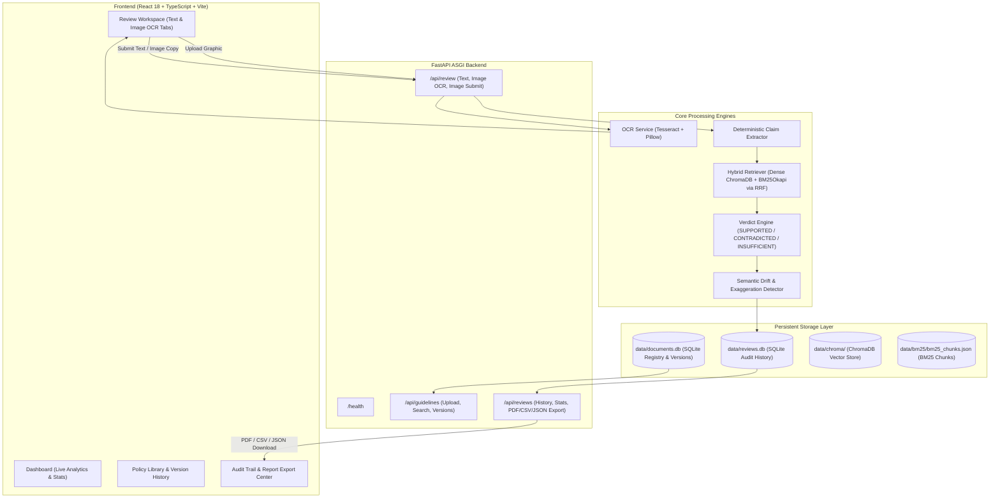

# BrandSentry AI — Brand Compliance Intelligence Platform

[](https://brandsentry-web.onrender.com)
[](https://brandsentry-api.onrender.com/docs)
[-10B981?style=for-the-badge)](https://brandsentry-api.onrender.com/health)
[](docs/TEST_REPORT.md)
[](docs/TEST_REPORT.md)

---

## 🌐 Live Production Deployment

BrandSentry AI is deployed in production on Render:

| Service | Public Endpoint URL | Purpose / Notes |
| :--- | :--- | :--- |
| **Frontend Web Application** | [https://brandsentry-web.onrender.com](https://brandsentry-web.onrender.com) | Interactive React + Vite compliance workspace |
| **Backend REST API** | [https://brandsentry-api.onrender.com](https://brandsentry-api.onrender.com) | FastAPI backend serving hybrid retrieval, review & audit |
| **API Interactive Documentation** | [https://brandsentry-api.onrender.com/docs](https://brandsentry-api.onrender.com/docs) | Interactive OpenAPI / Swagger UI test interface |
| **Backend Health Check** | [https://brandsentry-api.onrender.com/health](https://brandsentry-api.onrender.com/health) | Live service status (`status: "ok"`, uptime, version) |

*System Status: Operational & Connected.*

---

## 🚀 Round 3 Committed Improvements

### 1. Hybrid Retrieval & Measurable Evaluation
- **Sparse Lexical Search (BM25Okapi)**: Tokenized keyword inverted index indexing identical guideline passages, preserving chunk IDs, document IDs, source filenames, and page numbers with JSON persistence.
- **Reciprocal Rank Fusion (RRF)**: Fuses dense semantic search (`all-MiniLM-L6-v2` via ChromaDB) with BM25 lexical scores using the formula $RRF(d) = \sum \frac{1}{k + rank(d)}$ ($k=60$), combined with string deduplication to eliminate redundant evidence citations.
- **Empirical Evaluation Benchmark**: 60 meticulously labelled ground-truth scenarios across 10 failure categories (Exact Phrase, Semantic Paraphrase, Numerical Thresholds, Prohibited Phrases, Exceptions, Negation, Temporal, Scope, Missing Evidence, Similar Passages).
  - **Verdict Accuracy**: Hybrid (56.67%) vs Dense (55.00%) vs BM25 (55.00%).
  - **Latency**: Hybrid yields sub-8ms retrieval on CPU infrastructure.
  - Complete report: [`docs/RETRIEVAL_EVALUATION.md`](docs/RETRIEVAL_EVALUATION.md).

### 2. Policy Governance & Auditable Reviews
- **Immutable Policy Versioning**: Added `policy_versions` table in SQLite (`data/documents.db`) with unique version UUIDs, stable policy IDs, human-readable labels (`v1.0`, `v2.0`...), and cryptographic SHA-256 hashes. Multiple versions of the same policy coexist without destructive overwrites.
- **Persistent Review Auditing**: Dedicated SQLite store (`data/reviews.db`) recording review session UUID, source (`text` or `image`), exact policy version IDs used, aggregate counts, and complete JSON claims array with quotes, page numbers, and drift results.
- **Multi-Format Report Export**: One-click direct downloads for official compliance records:
  - **JSON**: Machine-readable audit payload.
  - **CSV**: Tabular breakdown of claim-by-claim verdicts, quotes, and suggested corrections.
  - **PDF**: Professional styled multi-page PDF generated via ReportLab with executive summary, metadata badges, verdict tables, evidence citations, and legal disclaimers.

### 3. Multimodal Visual Brand Compliance
- **OCR Service**: Integrates Tesseract OCR and Pillow image validation supporting PNG, JPEG, and WebP promotional creatives up to 10MB and 8000px dimensions.
- **Traceable Text Extraction**: Preprocessing via grayscale and autocontrast, word-level confidence scoring ($0.0 - 100.0\%$), and bounding boxes.
- **Human-in-the-Loop Review**: Marketers inspect extracted OCR text, view confidence metrics, and edit/correct typographical misrecognitions directly in the UI before compliance review.
- **Pipeline Reuse**: User-verified copy is evaluated through the exact same claim extraction, hybrid retrieval, and evidence-grounded verdict engine, with audit records marked as `review_source="image"`.

---

## 🔄 Technical Architecture



---

## 🛠️ Technology Stack

### Backend Stack
* **Language & Runtime**: Python 3.12+ (tested through 3.14.5)
* **API Framework**: FastAPI 0.115+ with Pydantic v2 schemas
* **Server**: Uvicorn ASGI
* **Vector Store**: ChromaDB with persistent on-disk storage
* **Dense Embeddings**: `all-MiniLM-L6-v2` via ONNX Runtime CPU inference (384 dimensions)
* **Lexical Retrieval**: `rank-bm25` (BM25Okapi)
* **Document Extraction**: PyMuPDF 2.0 (`fitz`)
* **OCR Engine**: Tesseract OCR + `pytesseract` + Pillow (PIL)
* **PDF Report Generation**: ReportLab
* **Metadata & Auditing**: SQLite (`data/documents.db`, `data/reviews.db`)

### Frontend Stack
* **Framework**: React 18.3 with TypeScript
* **Build Tool**: Vite 6
* **Icons**: Lucide React
* **Styling**: Vanilla CSS design system with curated HSL color tokens, dark mode accents, responsive grid, and accessible contrast

---

## 💻 Local Setup & Development

### Prerequisites
* **Python**: 3.12 or higher
* **Node.js**: v20 or higher
* **Git**
* **Tesseract OCR** (Optional for local OCR execution; backend container includes Tesseract automatically):
  - Linux: `sudo apt-get install tesseract-ocr tesseract-ocr-eng`
  - Windows: Install from [UB-Mannheim Tesseract](https://github.com/UB-Mannheim/tesseract/wiki) (default path: `C:\Program Files\Tesseract-OCR\tesseract.exe`)

### 1. Clone & Setup
```bash
git clone https://github.com/KPCHIRAGGUPTHA/BRAND_SENTRY_AI.git
cd BRAND_SENTRY_AI
git checkout round-3-final
```

### 2. Backend Setup
```bash
# Create and activate virtual environment
python -m venv backend/venv
source backend/venv/bin/activate  # On Windows: .\backend\venv\Scripts\Activate.ps1

# Install dependencies
pip install -r backend/requirements.txt

# Run backend development server
uvicorn backend.app.main:app --host 0.0.0.0 --port 8000 --reload
```
* Backend API: `http://127.0.0.1:8000`
* Swagger Documentation: `http://127.0.0.1:8000/docs`
* Health Check: `http://127.0.0.1:8000/health`

### 3. Frontend Setup
```bash
cd frontend
npm install
npm run dev
```
* Open `http://localhost:5173` in your browser.

---

## 🧪 Automated Testing & Verification

### Run Backend Test Suite (200 Tests Passing)
```bash
python -m pytest -q
```
Covers:
- Hybrid retrieval, BM25 indexing, and RRF fusion (`test_hybrid_retrieval.py`)
- Policy versioning, review audit persistence, and PDF/CSV exports (`test_policy_governance.py`)
- Image validation, format checks, and OCR extraction (`test_ocr_multimodal.py`)
- Review pipeline, input validation, and scoping regression (`test_review_api.py`)
- Verdict engine, deterministic rules, and evidence grounding (`test_verdict_engine.py`)
- Semantic drift categories and uncertainty guardrails (`test_semantic_drift.py`)
- ChromaDB vector store, distance metrics, and embeddings (`test_vector_store.py`)

### Run Frontend Test Suite (15 Tests Passing)
```bash
cd frontend
npm test -- --run
```

### Run Frontend Production Build
```bash
cd frontend
npm run build
```

### Run Retrieval Evaluation Benchmark
```bash
python backend/evaluation/evaluate_retrieval.py
```

---

## ⚠️ Known Limitations & Deployment Notes

1. **Free-Tier Render Ephemeral Storage**:
   The deployed backend runs on Render's free web service tier. On the free tier, the container spins down after 15 minutes of inactivity. When it restarts, the local filesystem resets to the clean base Docker container image. In production, attach a persistent disk volume mounted at `/app/backend/data/` or configure S3 / Cloud Storage connectors.
2. **Free-Tier Cold Starts**:
   When spinning up from standby, the initial cold start can take 30–50 seconds to initialize the ASGI container and load embedding models into memory. The frontend includes non-blocking connection indicators and bounded retry logic.
3. **Pure CPU Inference**:
   The ONNX embedding model and BM25 index run entirely on CPU without GPU acceleration, providing maximum deployment portability without recurring GPU costs.

---

## 📄 Documentation Sitemap

- [System Architecture Specification](docs/ARCHITECTURE.md)
- [Implementation Summary (Round 3 Improvements)](docs/IMPLEMENTATION_SUMMARY.md)
- [Retrieval Benchmark & Measured Evaluation Report](docs/RETRIEVAL_EVALUATION.md)
- [Feature Implementation & Verification Checklist](docs/FEATURE_CHECKLIST.md)
- [Testing & Quality Assurance Report](docs/TEST_REPORT.md)
- [Product & Engineering Roadmap](docs/ROADMAP.md)

---

## 🏆 Submission Information
**Team:** We Code Coders  
**Competition:** Round 3: The Final Round  
**Repository:** [https://github.com/KPCHIRAGGUPTHA/BRAND_SENTRY_AI.git](https://github.com/KPCHIRAGGUPTHA/BRAND_SENTRY_AI.git)  
**Branch:** `round-3-final`
