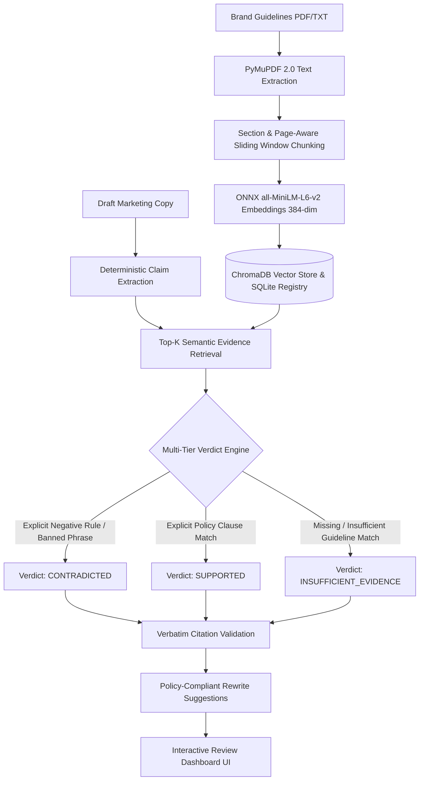

# BrandSentry AI — Brand Compliance & Claim Verification Platform

[](https://brandsentry-web.onrender.com)
[](https://brandsentry-api.onrender.com/docs)
[-10B981?style=for-the-badge)](https://brandsentry-api.onrender.com/health)
[](docs/EVALUATION_REPORT.md)

---

## 🌐 Live Production Deployment

BrandSentry AI is deployed in production on Render:

| Service | Public Endpoint URL | Purpose / Notes |
| :--- | :--- | :--- |
| **Frontend Web Application** | [https://brandsentry-web.onrender.com](https://brandsentry-web.onrender.com) | Interactive React + Vite compliance dashboard |
| **Backend REST API** | [https://brandsentry-api.onrender.com](https://brandsentry-api.onrender.com) | FastAPI backend serving review & guideline endpoints |
| **API Interactive Documentation** | [https://brandsentry-api.onrender.com/docs](https://brandsentry-api.onrender.com/docs) | Interactive OpenAPI / Swagger UI test interface |
| **Backend Health Check** | [https://brandsentry-api.onrender.com/health](https://brandsentry-api.onrender.com/health) | Live service status (`status: "ok"`, uptime, version) |

*System Status: Operational & Connected.*

---

## 💡 The Problem BrandSentry AI Solves

Marketing, PR, and growth teams produce high volumes of ad copy, social posts, landing pages, and press releases under tight deadlines. However, making unverified or misleading claims carries serious risks:

1. **Regulatory Sanctions & Fines**: The FTC, FDA, SEC, and international regulators heavily penalize unsubstantiated claims, absolute safety guarantees, and misleading comparisons.
2. **Brand & Legal Dilution**: Marketing copy that ignores internal brand guidelines damages brand reputation, dilutes trademarks, and violates approved messaging playbooks.
3. **Slow, Costly Review Bottlenecks**: Manual review by legal and compliance teams takes days or weeks, stalling go-to-market velocity.
4. **Hallucination Risks in Generic LLMs**: Off-the-shelf generative AI models frequently fabricate approvals, invent non-existent policy clauses, or fail to enforce strict negative prohibitions.

**BrandSentry AI solves this with an evidence-grounded, zero-hallucinated-approval compliance platform.** It extracts atomic claims from draft marketing copy, retrieves relevant clauses from uploaded brand guidelines via dense vector search, and applies a multi-tiered verification engine that produces **verifiable, citation-backed verdicts** with compliant rewrite suggestions.

---

## 🔄 End-to-End Workflow Architecture



### Step-by-Step Workflow:

1. **Guideline Upload & Validation**: Accepts PDF and TXT brand books via `POST /api/guidelines/upload`. Validates file MIME types, magic bytes, and enforces a 10MB size limit. Rejects scanned/empty PDFs without digital text.
2. **Document Extraction**: Uses PyMuPDF 2.0 to extract clean digital text page-by-page while preserving document hierarchy and exact page numbering.
3. **Deterministic Chunking**: Splits extracted text into ~400 token chunks with 50-token sliding overlap. Each chunk retains unique metadata (`chunk_id`, `document_id`, `page_number`, `source_filename`).
4. **Vector Indexing**: Generates 384-dimensional dense vector embeddings using local ONNX `all-MiniLM-L6-v2` running strictly on CPU. Chunks are persisted in ChromaDB with cosine distance indexing, while document metadata is tracked in SQLite (`data/documents.db`).
5. **Claim Extraction**: Decomposes unstructured marketing copy into discrete, testable atomic claims using sentence and clause boundaries with abbreviation awareness (e.g., `e.g.`, `i.e.`, `U.S.`, `vs.`).
6. **Evidence Retrieval**: Executes top-k cosine similarity queries against ChromaDB per claim, filtered by target document ID when specified.
7. **Three-Way Verdict Engine**:
   - **`SUPPORTED`**: The claim is explicitly validated and permitted by retrieved policy clauses.
   - **`CONTRADICTED`**: The claim violates an explicit restriction, prohibited term (e.g., "100% safe", "guaranteed harmless"), or policy rule.
   - **`INSUFFICIENT_EVIDENCE`**: The guideline does not contain sufficient factual or policy basis to verify the claim. **Crucially, missing evidence is never auto-approved.**
8. **Verbatim Citation Validation**: Guarantees that every cited quote is a strict character-for-character substring of the retrieved guideline passage, complete with page number and chunk ID.
9. **Suggested Corrections**: For contradicted or ungrounded claims, generates safe, compliant rewrites that eliminate prohibited superlatives and incorporate required regulatory qualifiers.

---

## 🛠️ Technology Stack & Architecture

### Backend Stack
* **Language & Runtime**: Python 3.12+ (tested through 3.14.5)
* **API Framework**: FastAPI 0.115+ with Pydantic v2 schemas
* **Server**: Uvicorn (ASGI)
* **PDF Extraction**: PyMuPDF 2.0 (`fitz`) with page-preserving digital extraction
* **Embedding Model**: `sentence-transformers/all-MiniLM-L6-v2` via ONNX Runtime CPU inference (384-dim dense vectors, zero GPU requirement)
* **Vector Store**: ChromaDB 1.5.x with persistent on-disk storage and cosine similarity
* **Metadata Store**: SQLite (`data/documents.db`)
* **Test Suite**: Pytest (151 unit, integration, and regression tests)

### Frontend Stack
* **Framework**: React 18.3 with TypeScript
* **Build Tool**: Vite 6
* **Styling**: Vanilla CSS design system with custom CSS variables, dark glassmorphism aesthetic, responsive cards, and accessible contrast
* **HTTP Client**: Native `fetch` with robust error parsing and timeout handling

### Deployment Architecture
* **Platform**: [Render](https://render.com)
* **Backend Web Service**: Docker container running on Render (`Dockerfile.backend`), binding to `$PORT` with CORS configured for deployed static origins.
* **Frontend Static Site**: Render Static Site CDN building from `frontend/` (`npm run build`), serving static assets with Single Page Application (SPA) rewrite rules to `/index.html`.
* **Zero External Paid API Dependency**: Embeddings and classification operate entirely on-device via ONNX CPU inference, guaranteeing high availability and predictable response times.

---

## 💻 Local Setup & Development

### Prerequisites
* **Python**: 3.12 or higher
* **Node.js**: v20 or higher
* **Git**

### 1. Clone the Repository
```bash
git clone https://github.com/KPCHIRAGGUPTHA/BRAND_SENTRY_AI.git
cd BRAND_SENTRY_AI
```

### 2. Backend Setup
```powershell
# Create and activate virtual environment
python -m venv backend/venv
.\backend\venv\Scripts\Activate.ps1

# Install dependencies
pip install -r backend/requirements.txt

# Run backend development server
uvicorn backend.app.main:app --host 0.0.0.0 --port 8000 --reload
```
* Backend API: `http://127.0.0.1:8000`
* Swagger Documentation: `http://127.0.0.1:8000/docs`
* Health Check: `http://127.0.0.1:8000/health`

### 3. Frontend Setup
In a new terminal:
```powershell
cd frontend
npm install
npm run dev
```
* Open `http://localhost:5173` in your browser.

---

## 🧪 Testing & Validation

### Run Backend Test Suite (151 Tests)
```powershell
.\backend\venv\Scripts\pytest.exe -v
```
All 151 tests validate health endpoints, PDF extraction, sliding-window chunking, ONNX embedding generation, vector store persistence, claim extraction, verdict classification, citation substring verification, and regression cases.

### Run Frontend Build Check
```powershell
cd frontend
npm run build
```
Validates TypeScript types and generates the production bundle without errors.

---

## ⚠️ Known Limitations & Deployment Notes

1. **Free-Tier Render Ephemeral Storage**:
   The deployed backend runs on Render's free web service tier. On the free tier, the container spins down after 15 minutes of inactivity. When it restarts, the local filesystem resets to the clean base Docker container image. Consequently, any uploaded guideline files stored in `data/uploads/`, vector collections in `data/chroma/`, and records in `data/documents.db` will be cleared on container restart. 
   *Note: In production environments, this is resolved by attaching a persistent volume (Render Starter plan with Disk or AWS S3 / Cloud Storage).*
2. **Free-Tier Cold Starts**:
   If the Render free backend has spun down due to inactivity, the first incoming request may take 30–50 seconds to initialize the container and load the ONNX embedding model into memory. Subsequent requests respond within normal sub-second latencies.
3. **Pure CPU Inference**:
   The ONNX embedding model runs entirely on CPU without GPU acceleration. While this makes the application fully portable and free of proprietary API dependencies, bulk ingestion of massive documents (500+ pages) will process sequentially.
4. **Scanned / Image-Only PDFs**:
   PyMuPDF digital extraction requires a digital text layer. Scanned image-only PDFs without OCR text layers are safely rejected with an explicit HTTP 422 error instructing the user to upload a digital text document.

---

## 📄 License & Attribution

Developed for the Brand Compliance Hackathon.  
Repository: [BRAND_SENTRY_AI](https://github.com/KPCHIRAGGUPTHA/BRAND_SENTRY_AI)
