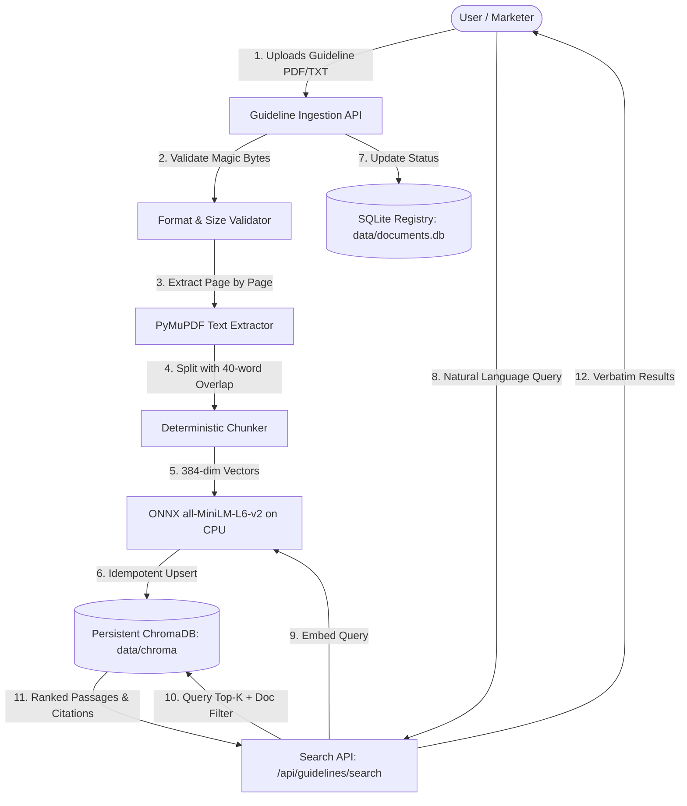

# BrandSentry AI — Application Architecture Specification

> **Phase:** Round 2 — Phase 2 (Guideline Ingestion & Retrieval Foundation)  
> **Status:** Foundational RAG Pipeline Implemented & Verified (33 Tests Passing)  
> **Target Deadline:** 25 October 2026, 10:00 AM IST  

---

## 1. Architectural Philosophy & Core Constraints

BrandSentry AI is designed for automated, verifiable brand compliance and marketing claim audit. The system adheres to strict engineering and compliance principles:

1. **Zero Hallucinated Approvals**: A marketing claim must **never** be marked as `SUPPORTED` simply because no conflicting guideline passage was retrieved. If evidence is lacking or indeterminate, the verdict **must** be `INSUFFICIENT_EVIDENCE`.
2. **Evidence-Grounded Reasoning**: All verdicts must cite verifiable, exact source guideline segments (document name, page number, clause ID, or quoted guideline text).
3. **Provider-Agnostic LLM Layer**: The core review engine interfaces with large language models through an abstracted, strongly-typed interface accepting configurable providers (Gemini, OpenAI, Anthropic, or local models) via environment variables.
4. **Deterministic Pre-Filtering**: Exact terminology violations (e.g. prohibited superlatives, trademark casing, restricted disclaimers) are caught deterministically prior to LLM reasoning to ensure 100% precision and lower latency/cost.
5. **Separation of Concerns**: Clean boundaries between React client presentation, FastAPI ASGI request routing, chunking/retrieval micro-services, and LLM inference.

---

## 2. Component Implementation Status

| Component # | Component Description | Current Status | Phase | Notes |
| :--- | :--- | :--- | :--- | :--- |
| **01** | **React 18 + TypeScript Client** | **IMPLEMENTED & TESTED** | Phase 1 & 2 | Interactive GuidelineExplorer + Health monitor. |
| **02** | **FastAPI ASGI Backend** | **IMPLEMENTED & TESTED** | Phase 1 & 2 | `/health`, `/api/guidelines/upload`, `/api/guidelines/search`. |
| **03** | **Guideline Ingestion Service** | **IMPLEMENTED & TESTED** | Phase 2 | Format validation, size limits (10MB), secure file persistence. |
| **04** | **Text Extraction & Chunking** | **IMPLEMENTED & TESTED** | Phase 2 | PyMuPDF page-preserving extraction + sliding window chunker. |
| **05** | **Embedding Generation Engine** | **IMPLEMENTED & TESTED** | Phase 2 | `all-MiniLM-L6-v2` ONNX CPU model, unit normalized, 384 dims. |
| **06** | **ChromaDB Vector Retrieval** | **IMPLEMENTED & TESTED** | Phase 2 | Persistent ChromaDB (`data/chroma/`), cosine similarity, filter by doc_id. |
| **07** | **SQLite Document Registry** | **IMPLEMENTED & TESTED** | Phase 2 | Metadata store (`data/documents.db`) tracking upload/index status. |
| **08** | **Claim Extraction Pipeline** | **PLANNED** | Phase 3 | Decomposes copy into atomic, verifiable test claims. |
| **09** | **Deterministic Compliance Checks** | **PLANNED** | Phase 3 (P1) | Regex & keyword screening for banned words / casing. |
| **10** | **Claim-Type Retrieval Routing** | **PLANNED** | Phase 3 (P1) | Category routing (Product, Voice, Regulatory). |
| **11** | **Evidence-Grounded LLM Review** | **PLANNED** | Phase 3 | Strict evidence-only LLM evaluator. |
| **12** | **Three-Way Verdict Engine** | **PLANNED** | Phase 3 | `SUPPORTED`, `CONTRADICTED`, `INSUFFICIENT_EVIDENCE`. |
| **13** | **Citation Validation Service** | **PLANNED** | Phase 4 | Exact excerpt verifier guarding against hallucinations. |
| **14** | **Suggested Corrections Engine** | **PLANNED** | Phase 4 | Policy-compliant rewrite generator. |

---

## 3. Implemented Pipeline Deep Dive (Phase 2)

### A. Document Upload & Format Verification (`POST /api/guidelines/upload`)
- **File Integrity**: Inspects magic bytes (`%PDF-` for PDF, UTF-8/UTF-8-BOM decodability for TXT). Rejects executables, Office docs, empty files (0 bytes), and oversized files (> 10MB) before processing.
- **Scanned PDF Guard**: Detects documents containing 0 digital text across all pages and returns an explicit `HTTP 422 Unprocessable Entity` indicating OCR is required.
- **UUID & Path Isolation**: Assigns random UUIDv4 and stores files under `data/uploads/` using sanitized server filenames. No internal filesystem paths are exposed in API payloads.

### B. Extraction & Section-Aware Chunking
- **Page Preservation**: Extracts text page by page with PyMuPDF, attaching 1-indexed `page_number` to every chunk.
- **Sliding Window Chunking**: Chunks pages with configurable window size (`CHUNK_SIZE_WORDS = 300`) and overlap (`CHUNK_OVERLAP_WORDS = 40`), maintaining context across chunk boundaries while preserving raw text for citations.

### C. Embedding & ChromaDB Persistence
- **Model**: Local ONNX `all-MiniLM-L6-v2` (384-dimensional dense vectors), running strictly on CPU with lazy initialization and in-memory caching.
- **Normalization**: Vectors are L2 unit-normalized, ensuring cosine distance $D \in [0, 2]$.
- **Idempotency**: Indexed via ChromaDB `upsert`, preventing duplicate entries on repeated uploads or retries.
- **Persistence**: Saved under `data/chroma/`, verified to reload across application restarts.

### D. Semantic Passage Retrieval (`POST /api/guidelines/search`)
- Accepts query string (max 1000 characters) and optional `document_id`.
- Embeds query and executes vector similarity search in ChromaDB.
- Returns matched passages with `chunk_id`, `document_id`, `source_filename`, `page_number`, `distance`, `similarity_score`, and exact verbatim text snippet.

---

## 4. End-to-End Data Flow

