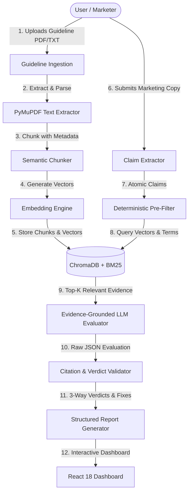

# BrandSentry AI — Application Architecture Specification

> **Phase:** Round 2 — Phase 1 (Foundation & Setup)  
> **Status:** Foundational Architecture Established (Phases 2–8 Roadmap Defined)  
> **Target Deadline:** 25 October 2026, 10:00 AM IST  

---

## 1. Architectural Philosophy & Core Constraints

BrandSentry AI is designed for automated, verifiable brand compliance and marketing claim audit. The system adheres to strict engineering and compliance principles:

1. **Zero Hallucinated Approvals**: A marketing claim must **never** be marked as `SUPPORTED` simply because no conflicting guideline passage was retrieved. If evidence is lacking or indeterminate, the verdict **must** be `INSUFFICIENT_EVIDENCE`.
2. **Evidence-Grounded Reasoning**: All verdicts must cite verifiable, exact source guideline segments (document name, page number, clause ID, or quoted guideline text).
3. **Provider-Agnostic LLM Layer**: The core review engine interfaces with large language models through an abstracted, strongly-typed interface accepting configurable providers (Gemini, OpenAI, Anthropic, or local models) via environment variables.
4. **Deterministic Pre-Filtering**: Exact terminology violations (e.g. prohibited superlatives, trademark casing, restricted disclaimers) are caught deterministically prior to LLM reasoning to ensure 100% precision and lower latency/cost.
5. **Separation of Concerns**: Clean boundaries between React client presentation, FastAPI ASGI request routing, chunking/retrieval micro-services, and LLM inference.

---

## 2. Component Implementation Status

| Component # | Component Description | Current Status | Target Phase |
| :--- | :--- | :--- | :--- |
| **01** | **React 18 + TypeScript Client** | **IMPLEMENTED & TESTED (Health UI)** | Phase 1 (Full UI in Phase 5) |
| **02** | **FastAPI ASGI Backend** | **IMPLEMENTED & TESTED (Health API)** | Phase 1 (Core API in Phase 2/3) |
| **03** | **Guideline Ingestion Service** | **PLANNED** | Phase 2 |
| **04** | **Text Extraction & Chunking** | **PLANNED** | Phase 2 |
| **05** | **Embedding Generation Engine** | **PLANNED** | Phase 2 |
| **06** | **ChromaDB Vector Retrieval** | **PLANNED** | Phase 2 |
| **07** | **Claim Extraction Pipeline** | **PLANNED** | Phase 3 |
| **08** | **Deterministic Compliance Checks** | **PLANNED** | Phase 3 (P1) |
| **09** | **Claim-Type Retrieval Routing** | **PLANNED** | Phase 3 (P1) |
| **10** | **Evidence-Grounded LLM Review** | **PLANNED** | Phase 3 |
| **11** | **Three-Way Verdict Engine** | **PLANNED** | Phase 3 |
| **12** | **Citation Validation Service** | **PLANNED** | Phase 4 |
| **13** | **Suggested Corrections Engine** | **PLANNED** | Phase 4 |
| **14** | **Structured Review Report** | **PLANNED** | Phase 4 & 5 |

---

## 3. Detailed Component Architecture

### Component 01: React Frontend (`frontend/src/`)
- **Implemented in Phase 1**: Modular client with TypeScript, dark-mode glassmorphic design system, health status polling with graceful error states, and responsive layouts.
- **Planned for Phase 5**: Upload dropzone for guideline documents (PDF/TXT), live chunking progress, rich marketing copy editor, side-by-side claim verification cards with color-coded badges, clickable citation drawers, and single-click correction applicator.

### Component 02: FastAPI Backend (`backend/app/`)
- **Implemented in Phase 1**: ASGI application with CORS middleware, centralized Pydantic settings (`backend/app/core/config.py`), and verified `/health` endpoint.
- **Planned for Phases 2–5**: RESTful router modules (`backend/app/api/`):
  - `POST /api/guidelines/upload`: Multi-part document upload and ingestion.
  - `GET /api/guidelines`: List indexed guideline rulesets.
  - `POST /api/review/analyze`: Full-text marketing copy claim audit endpoint.
  - `POST /api/review/correct`: Claim correction suggestion generator.

### Component 03: Guideline Ingestion Service (`backend/app/services/ingestion.py`)
- **Status**: Planned (Phase 2).
- Validates uploaded file types (MIME detection for application/pdf and text/plain).
- Persists raw source documents into `data/uploads/` with UUID-based deduplication and timestamp tracking.

### Component 04: Text Extraction and Chunking (`backend/app/services/chunking.py`)
- **Status**: Planned (Phase 2).
- Extracts text via PyMuPDF (`fitz`), preserving page numbers, heading hierarchies, bullet items, and table structures.
- Chunking strategy: Semantic section-aware windowing (~300–500 tokens with 50-token overlap). Every chunk retains rich metadata:
  ```json
  {
    "document_id": "guideline_01",
    "page_number": 4,
    "section_title": "Product Performance Claims & Disclaimers",
    "chunk_id": "chunk_01_p4_c2",
    "text": "..."
  }
  ```

### Component 05: Embedding Generation (`backend/app/retrieval/embeddings.py`)
- **Status**: Planned (Phase 2).
- Abstracted embedding interface supporting local SentenceTransformers (`all-MiniLM-L6-v2`) or remote embedding APIs.
- Normalized vector outputs for cosine similarity computations.

### Component 06: ChromaDB Vector Retrieval (`backend/app/retrieval/vector_store.py`)
- **Status**: Planned (Phase 2).
- Local persistent ChromaDB instance housed at `data/chroma/`.
- Collection management isolated per guideline version.
- Hybrid querying capability: Dense vector nearest-neighbor search coupled with BM25 lexical search (`rank-bm25`) for regulatory keywords and brand-mandated terminology.

### Component 07: Claim Extraction Pipeline (`backend/app/services/claim_extractor.py`)
- **Status**: Planned (Phase 3).
- Takes unstructured marketing copy (e.g., social ads, press releases, landing page copy, packaging text).
- Segments text into atomic, verifiable compliance claims (factual, comparative, superlative, regulatory, and trademark claims).
- Output: List of structured claim objects with character offsets.

### Component 08: Deterministic Compliance Checks (`backend/app/review/deterministic.py`)
- **Status**: Planned (Phase 3 / P1).
- Regex-based and rule-based pre-screener checking:
  - Banned words / forbidden claims (e.g. unqualified "guaranteed", "100% cure").
  - Trademark styling rules (e.g. incorrect capitalization or missing registered symbols).
  - Required disclaimers (e.g. "Terms & Conditions apply").

### Component 09: Claim-Type Retrieval Routing (`backend/app/retrieval/router.py`)
- **Status**: Planned (Phase 3 / P1).
- Classifies claims into categories (Tone & Voice, Product Claims, Regulatory/Legal, Visual/Brand Identity).
- Routes query expansion and metadata filters to relevant subsets of the vector store to maximize recall of applicable rules.

### Component 10: Evidence-Grounded LLM Review (`backend/app/review/evaluator.py`)
- **Status**: Planned (Phase 3).
- Structured LLM prompt instructing the model to act as an objective compliance auditor.
- Strict grounding constraint: The LLM may ONLY use the retrieved guideline evidence to evaluate the claim.
- Output schema enforces structured JSON with strict type validation via Pydantic.

### Component 11: Three-Way Verdict Generation
- **Status**: Planned (Phase 3).
- Explicit, mutually exclusive verdict taxonomy:
  1. `SUPPORTED`: The claim directly aligns with explicit permissions or required statements in the guidelines. Verifiable citation required.
  2. `CONTRADICTED`: The claim violates, contradicts, or exceeds restrictions established in the guidelines. Verifiable citation and violation explanation required.
  3. `INSUFFICIENT_EVIDENCE`: No matching guideline passage was found, or guidelines do not provide sufficient criteria to confirm or refute. No automatic approval.

### Component 12: Citation Validation Service (`backend/app/review/citation_validator.py`)
- **Status**: Planned (Phase 4).
- Cross-checks citations returned in the LLM response against the actual retrieved chunk text in memory.
- Guards against hallucinated page numbers or fabricated quotation text. Marks unverified citations with a warning flag.

### Component 13: Suggested Corrections Engine (`backend/app/review/corrections.py`)
- **Status**: Planned (Phase 4).
- For claims marked `CONTRADICTED` or `INSUFFICIENT_EVIDENCE`, generates policy-compliant rewrite suggestions.
- Preserves the marketing intent and brand tone while stripping forbidden superlatives or injecting required qualifiers/disclaimers.

### Component 14: Structured Review Report (`backend/app/schemas/report.py`)
- **Status**: Planned (Phase 4 & 5).
- Comprehensive JSON schema representing the full audit session:
  - Document & copy metadata
  - Overall compliance score (percentage of supported vs contradicted claims)
  - Claim-by-claim breakdown with verdicts, confidence scores, citations, and suggested replacements
  - Exportable format for compliance records.

---

## 4. End-to-End Data Flow



---

## 5. Security & Isolation Considerations
- **No Hardcoded Keys**: API keys and secrets are injected strictly via `.env` files or runtime environment variables.
- **Isolated File Storage**: User uploaded guidelines are sequestered in `data/uploads/` and ignored by version control.
- **CORS Safeguards**: Backend strictly restricts CORS origins to authorized frontend development ports.
