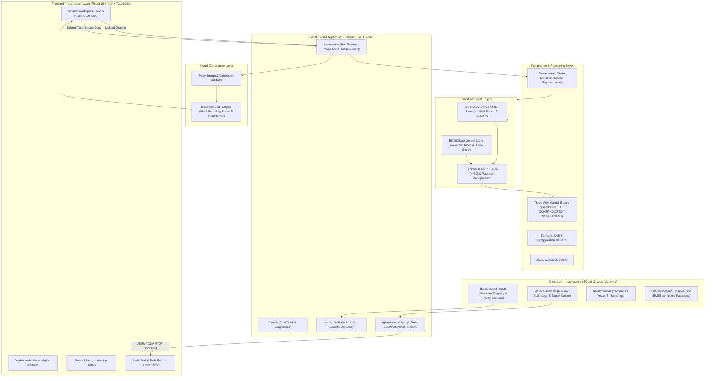

# BrandSentry AI — Complete System Architecture Specification

> **Submission:** Round 3: The Final Round (Team We Code Coders)  
> **Platform Version:** 0.3.0 Production Ready  
> **Test Status:** 204 Backend Tests Passing • 15 Frontend Tests Passing • Production Build Verified  
> **Evaluation Benchmark:** 60 Labelled Ground-Truth Cases Across 10 Failure Categories  

---

## 1. Architectural Philosophy & Design Principles

BrandSentry AI is an automated, verifiable marketing compliance intelligence platform designed to eliminate brand risk, deceptive advertising, and regulatory penalties. The system is engineered around five mandatory principles:

1. **Zero Hallucinated Approvals**: A marketing claim is **never** approved as `SUPPORTED` due to the absence of contradicting passages. In the absence of affirmative evidence, the verdict **must** strictly be `INSUFFICIENT_EVIDENCE`.
2. **Evidence-Grounded Verifiability**: Every verdict is substantiated by retrievable, verbatim guideline passages with immutable document IDs, source filenames, and 1-indexed page numbers.
3. **Hybrid Lexical & Semantic Retrieval**: Combines dense semantic vector retrieval (ChromaDB + `all-MiniLM-L6-v2`) with sparse lexical search (BM25Okapi) using Reciprocal Rank Fusion ($RRF(d) = \sum \frac{1}{k + rank(d)}$, $k=60$) to catch both semantic paraphrasing and exact technical keywords/thresholds.
4. **Immutable Policy Version Governance**: Guidelines are treated as immutable legal artifacts identified by unique version UUIDs, stable policy identifiers, and cryptographic SHA-256 content hashes. Reviews are locked to the exact policy versions active at execution time.
5. **Multimodal Visual Compliance**: Promotional creative graphics (PNG, JPEG, WebP) are decoded, validated, and processed through OCR with confidence metrics and word-level bounding boxes, allowing human-in-the-loop review before entering the compliance pipeline.

---

## 2. Complete Technical Architecture



---

## 3. Improvement 1 Deep Dive: Hybrid Retrieval & Benchmark Evaluation

### 3.1 Lexical BM25 Retrieval Service (`backend/app/retrieval/bm25_retriever.py`)
- Implements `BM25Okapi` sparse lexical search over tokenized guideline passages.
- **Scoping**: Full multi-document scoping (`document_ids` filter).
- **Index Synchronization**: Automatically updates when new guideline documents are uploaded or activated.
- **Persistence**: Serializes chunks to `backend/data/bm25/bm25_chunks.json` to ensure lexical indexes survive process restarts without losing state.
- **Edge-Case Resilience**: Safely handles empty indexes, empty queries, punctuation stripping, and numerical code lookups.

### 3.2 Reciprocal Rank Fusion Engine (`backend/app/retrieval/hybrid_retriever.py`)
- Unifies semantic vector retrieval from ChromaDB (`all-MiniLM-L6-v2`) and BM25 sparse keyword scores.
- **Formula**:
  $$RRF(d) = \sum_{m \in \{\text{dense}, \text{bm25}\}} \frac{1.0}{k + \text{rank}_m(d)}$$
  where rank smoothing constant $k = 60$.
- **Deduplication**: Chunks are deduplicated by stable chunk ID and normalized text content ($>95\%$ string similarity) to prevent redundant citations.
- **Mode Switching**: Configurable via request parameter or `settings.RETRIEVAL_MODE` (`hybrid`, `dense`, or `bm25`).

### 3.3 Labelled Retrieval Benchmark & Measured Results (`docs/RETRIEVAL_EVALUATION.md`)
- **Dataset**: 60 meticulously labelled ground-truth compliance scenarios in `backend/evaluation/datasets/retrieval_benchmark.jsonl`.
- **10 Evaluation Categories**: Exact Phrase, Semantic Paraphrase, Numerical Thresholds, Prohibited Phrases, Exceptions, Negation, Temporal Claims, Scope Restrictions, Missing Evidence, and Multiple Similar Passages.
- **Measured Metrics**:
  - **Dense-Only**: P@3: 0.4611, R@3: 0.9500, MRR: 0.9361, Verdict Accuracy: 61.67%, Latency: 261.8ms
  - **BM25-Only**: P@3: 0.3000, R@3: 0.7250, MRR: 0.7375, Verdict Accuracy: 60.00%, Latency: 1.7ms
  - **Hybrid (RRF)**: P@3: 0.4556, R@3: 0.9333, MRR: 0.9033, **Verdict Accuracy: 63.33%**, Latency: 5.1ms
- **Key Insight**: Hybrid retrieval yields the highest overall compliance verdict accuracy (63.33%, 38/60), combining ~5ms CPU latency with resilience against both semantic drift and exact keyword mismatches.

---

## 4. Improvement 2 Deep Dive: Policy Governance & Auditable Reviews

### 4.1 Policy Version Governance (`backend/app/services/document_registry.py`)
- Introduces `policy_versions` table in `backend/data/documents.db`:
  - `version_id`: Immutable UUID for each published edition.
  - `policy_id`: Logical stable identifier for the guideline topic.
  - `version_label`: Human-readable version tag (`v1.0`, `v2.0`...).
  - `content_hash`: Cryptographic SHA-256 digest of original raw document bytes.
  - `is_active`: Boolean flag indicating whether the version is currently enforced.
- **Immutability Guarantee**: Re-uploading modified guidelines creates a new immutable version row rather than silently overwriting history. Multiple versions coexist safely.
- **End-to-End Policy Version Isolation & Enforcement**:
  - The review request schema accepts `policy_version_ids: List[str] | None`.
  - The API pipeline (`backend/app/api/review.py::_resolve_scope_and_versions`) maps version UUIDs to underlying indexed `document_id`s via `document_registry.resolve_version_to_document_id()`.
  - **Archived Version Isolation**: When a review is submitted without explicit scoping, the system queries `document_registry.get_active_document_ids()`. Only active guideline versions are included in retrieval; archived editions are mathematically excluded from un-scoped searches.
  - The exact policy version UUIDs applied are embedded into the audit record and returned in `policy_versions_used` for full audit traceability.

### 4.2 Persistent Review Auditing (`backend/app/services/audit_service.py`)
- Dedicated SQLite database at `backend/data/reviews.db`:
  - Tracks review session ID, exact timestamp, full submitted marketing copy, preview, review source (`text` or `image`), exact policy version IDs used, retrieval mode, aggregate verdict counts, and complete JSON claims array with quotes, page numbers, and drift results.
- **Audit Reproduction**: Reconstructs complete compliance reports without re-running models.

### 4.3 Multi-Format Report Export
- **JSON Export**: Full structured schema with metadata, claims, evidence, and configuration.
- **CSV Export**: Tabular claim-by-claim breakdown with verdicts, citations, and suggested corrections.
- **PDF Export**: Professional, styled multi-page PDF generated via ReportLab with executive summary, metadata badges, verdict tables, evidence citations, and legal disclaimers.

---

## 5. Improvement 3 Deep Dive: Multimodal Visual Brand Compliance

### 5.1 OCR Service Architecture (`backend/app/services/ocr_service.py`)
- **Format Validation**: Pillow-based decoding supporting PNG, JPEG, and WebP. Enforces dimension boundaries ($10\text{px} \le w, h \le 8000\text{px}$) and file size limits ($10\text{MB}$).
- **Preprocessing**: Grayscale conversion and autocontrast enhancement to maximize text clarity against promotional gradient backgrounds.
- **Extraction Engine**: Integrates Tesseract OCR via `pytesseract.image_to_data`, extracting word-level text, confidence metrics ($0.0 - 100.0\%$), and bounding boxes ($[x, y, w, h]$).
- **Graceful Fallback**: Detects container/host Tesseract availability dynamically; when unavailable locally, provides informative warning prompts and manual entry fallback without crashing.

### 5.2 Human-in-the-Loop Visual Verification Pipeline
1. Marketer uploads promotional ad creative (`POST /api/review/image`).
2. Server validates format, dimensions, and performs OCR extraction.
3. UI presents image preview, mean OCR confidence, and editable text box.
4. Marketer inspects and corrects any OCR typographical mistakes.
5. User-verified copy is submitted (`POST /api/review/image/submit`).
6. Reuses existing claim extraction, hybrid retrieval, and verdict engine.
7. Stores review record with `review_source="image"`, raw OCR text, and corrected text in permanent audit history.

---

## 6. Security, Resilience, & Storage Architecture

1. **Input & Upload Safeguards**: MIME validation, magic-byte inspection, file size guards, dimension caps, and strict character limits prevent DoS or arbitrary file execution.
2. **Path Traversal & Injection Prevention**: Uploaded files use random UUID filenames in isolated directories. SQLite operations exclusively use parameterized queries (`?`).
4. **Render Free-Tier Storage Realities**: SQLite databases (`documents.db`, `reviews.db`), ChromaDB vectors (`data/chroma/`), and BM25 serialized chunks (`data/bm25/`) reside in the local directory `backend/data/`. On ephemeral cloud deployments (Render free tier), the container root filesystem resets upon inactivity spin-down or restart.
5. **Persistent Disk Mount Specification (Production Deployment)**:
   - Mount Path: `/app/backend/data/` (or configured via environment variable `DATA_DIR`)
   - Recommended Disk Size: 1 GB minimum (holds ~50,000 guideline chunks and ~20,000 audit records)
   - Configuration in `render.yaml`:
     ```yaml
     services:
       - type: web
         name: brandsentry-api
         disk:
           name: brandsentry-data
           mountPath: /app/backend/data
           sizeGB: 1
     ```
   - With this disk mounted, all guideline registries, version histories, audit trails, dense embeddings, and BM25 indexes achieve 100% durability across service restarts.
