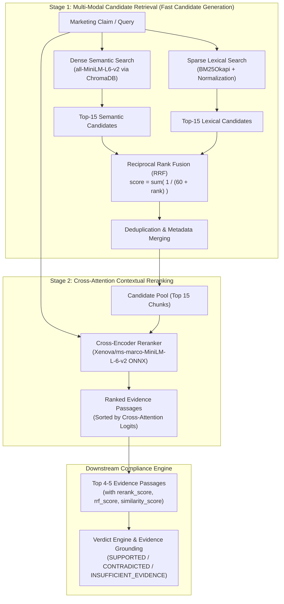

# BrandSentry AI — Hybrid Retrieval & Reranking Architecture

**System Component**: Multi-Stage Evidence Retrieval & Cross-Encoder Reranking Engine  
**Release Stage**: Stage 2 (Branch: `round-3-final`)  
**Quality Priority**: Retrieval Relevance > Evidence Grounding > System Reliability > Latency  

---

## 1. Architectural Overview

BrandSentry AI automates marketing compliance reviews by extracting verifiable claims from advertising copy and evaluating each claim strictly against uploaded organizational brand guidelines and regulatory policies. The downstream Verdict Engine (`backend/app/services/verdict_engine.py`) determines whether each claim is `SUPPORTED`, `CONTRADICTED`, or `INSUFFICIENT_EVIDENCE`.

To ensure the Verdict Engine receives the most contextually relevant, authoritative policy passages, BrandSentry AI implements a **two-stage hybrid retrieval and cross-encoder reranking pipeline**:

---

## 2. Dense Retrieval Design

### 2.1 Model & Representation
- **Model**: `all-MiniLM-L6-v2` (`sentence-transformers/all-MiniLM-L6-v2` via ChromaDB ONNX `ONNXMiniLM_L6_V2`).
- **Dimensions**: 384 dense floating-point dimensions.
- **Vector Space & Metric**: Cosine distance in ChromaDB (`hnsw:space: cosine`).
  $$\text{Cosine Distance } d = 1.0 - \frac{\mathbf{u} \cdot \mathbf{v}}{\|\mathbf{u}\| \|\mathbf{v}\|}$$
  $$\text{Similarity Score } s = 1.0 - d$$
- **Storage**: ChromaDB `PersistentClient` residing in `backend/data/chroma`.

### 2.2 Strengths & Failure Modes
- **Strengths**: Dense embeddings excel at high-level semantic generalization, understanding synonyms (e.g. *"zero vulnerabilities"* $\leftrightarrow$ *"100% bug free"*), paraphrases, and conceptual abstractions where words do not literally match.
- **Failure Modes**:
  1. Misses exact alphanumeric codes (e.g. *"registration 9845-A"* vs *"9845-B"*).
  2. Struggles with specific quantitative thresholds (e.g. *"20px margin"* vs *"50px margin"*).
  3. Susceptible to embedding drift when processing specialized legal or regulatory terminology.

---

## 3. Sparse Lexical Retrieval (BM25) Design

### 3.1 Algorithm & Implementation
- **Algorithm**: `BM25Okapi` (`rank-bm25`).
- **Persistence**: Thread-safe inverted index serialized via Python `pickle` in `backend/data/bm25/bm25_index.pkl`.
- **Tokenization Pipeline**:
  1. Case folding (`.lower()`).
  2. Alphanumeric token extraction using regex `\b\w+\b` to preserve numerals, measurements (e.g., `20px`), and alphanumeric identifiers (e.g., `9845-a`).
  3. Punctuation stripping without discarding hyphenated numerical codes.

### 3.2 Scoring Formula
For a query $Q = \{q_1, \dots, q_n\}$ and chunk $D$:
$$\text{BM25}(D, Q) = \sum_{i=1}^n \text{IDF}(q_i) \cdot \frac{f(q_i, D) \cdot (k_1 + 1)}{f(q_i, D) + k_1 \cdot \left(1 - b + b \cdot \frac{|D|}{\text{avgdl}}\right)}$$
- Hyperparameters: $k_1 = 1.5$ (term frequency saturation), $b = 0.75$ (document length normalization).

### 3.3 Strengths & Failure Modes
- **Strengths**: Deterministic lexical precision. It retrieves exact policy phrases, literal prohibited words (e.g., *"clinically proven"*), and exact dimensions with 100% reliability.
- **Failure Modes**:
  1. Zero recall for vocabulary mismatch (synonyms or paraphrase queries with 0 common words return empty results).
  2. Insensitive to word ordering and syntactic negation when terms are scattered across large passages.

---

## 4. Reciprocal Rank Fusion (RRF) & Calibration

### 4.1 Fusion Formula
To fuse rankings from dense vector search and BM25 lexical search without calibrating disparate raw score scales (cosine similarity in $[0, 1]$ vs unbounded BM25 scores $[0, \infty)$), BrandSentry AI uses **Reciprocal Rank Fusion**:

$$RRF(d) = \sum_{m \in \{\text{dense}, \text{bm25}\}} \frac{1}{k + \text{rank}_m(d)}$$

Where:
- $\text{rank}_m(d) \in \{1, 2, 3, \dots\}$ represents the 1-based rank position of candidate chunk $d$ in the retrieval modality $m$. If chunk $d$ is not retrieved by modality $m$, its term is 0.
- $k$ is the smoothing constant (configured to $k = 60$).

### 4.2 Calibration of Smoothing Constant $k=60$
- At $k = 60$, an item ranked #1 in both Dense and BM25 achieves:
  $$RRF = \frac{1}{61} + \frac{1}{61} \approx 0.03279$$
- An item ranked #1 in BM25 but unranked in Dense receives $\frac{1}{61} \approx 0.01639$.
- An item ranked #2 in both modalities receives $\frac{1}{62} + \frac{1}{62} \approx 0.03226$, ranking higher than an item appearing in only one modality.
- This creates smooth, balanced rank merging without allowing extreme outliers in either search engine to monopolize the top candidate slots.

---

## 5. Cross-Encoder Reranking Design

### 5.1 Architecture & Model Choice
- **Model**: `Xenova/ms-marco-MiniLM-L-6-v2` (quantized ONNX, 8-bit dynamic quantization).
- **Disk Footprint**: ~22.9 MB.
- **Inference Runtime**: `onnxruntime` (v1.31.0) running natively on CPU via `CPUExecutionProvider`.
- **Tokenization**: HuggingFace `tokenizers` FastTokenizer (`tokenizer.json`, max length 256 tokens).

### 5.2 Deep Cross-Attention vs Dual Bi-Encoder
In bi-encoders (dense retrieval), the query vector $\mathbf{u} = E(Q)$ and passage vector $\mathbf{v} = E(D)$ are computed independently, and relevance is approximated as an inner product. This cannot capture fine-grained token-level cross-interactions:

$$\text{Bi-Encoder: } \text{score}(Q, D) = \langle E(Q), E(D) \rangle$$

In contrast, the Cross-Encoder feeds the concatenation of query and passage jointly into all 6 bidirectional transformer layers:

$$\text{Cross-Encoder: } \text{score}(Q, D) = \text{Transformer}(\text{[CLS]} \circ Q \circ \text{[SEP]} \circ D \circ \text{[SEP]})$$

Every token in the claim attends to every token in the guideline chunk across all attention heads. This detects subtle semantic relationships, such as conditionality, scope exceptions, and contextual contradictions that bi-encoders miss.

### 5.3 Score Semantics & Safety Safeguard
- **Logit Range**: Cross-encoder logits typically range from $[-11, +11]$.
- **Usage Rule**: The reranker score is **strictly for relative candidate ordering**. It is never treated as a calibrated probability of truth or compliance confidence.
- **Stage 1 Protection**: Downstream evidence validation (`backend/app/services/verdict_engine.py`) continues to enforce exact verbatim quote verification, guideline existence checks, and universal warning separation.
- **Fail-Safe Mechanism**: If ONNX initialization fails, memory is constrained, or an unexpected exception occurs during inference, the service logs the error and gracefully returns the RRF rank order without breaking the review pipeline.

---

## 6. End-to-End Benchmark & Measured Performance

Evaluated against the 60-query benchmark dataset (`backend/evaluation/datasets/retrieval_benchmark.jsonl`) across 10 distinct compliance categories under controlled, isolated conditions:

| Architecture | Recall @ 1 | Recall @ 3 | Recall @ 5 | Recall @ 10 | Precision @ 3 | MRR | nDCG @ 3 | Verdict Acc | Cold Latency (Mean) | Warm Latency (p50) |
| :--- | :---: | :---: | :---: | :---: | :---: | :---: | :---: | :---: | :---: | :---: |
| **Dense Only** | 0.8472 | 0.9500 | 0.9667 | 0.9833 | 0.4611 | 0.9385 | 0.9310 | 55.00% | 295.7 ms | 3.9 ms |
| **BM25 Only** | 0.6389 | 0.7250 | 0.7500 | 0.7833 | 0.3000 | 0.7392 | 0.7109 | 51.67% | 0.3 ms | 0.2 ms |
| **Hybrid RRF** | 0.7972 | 0.9333 | 0.9667 | 0.9833 | 0.4556 | 0.9061 | 0.8958 | 56.67% | 288.3 ms | 4.8 ms |
| **Hybrid + Rerank** | **0.8306** | **0.9167** | **0.9500** | **0.9667** | **0.4444** | **0.9167** | **0.8982** | **56.67%** | 812.9 ms | 562.3 ms |

*Note: Cold latency includes ONNX query embedding generation (~285ms) for unique novel claims; Warm latency reflects steady-state execution with warm embedding cache. All measurements on CPU without GPU acceleration.*

---

## 7. Latency Profile & Timing Investigation Findings

### 7.1 Component Breakdown
- **Embedding Generation (Cold ONNX)**: ~292.9 ms
- **Embedding Retrieval (Warm / Cached)**: 0.01 ms
- **ChromaDB Vector Search (`top_k=15`)**: 4.8 ms
- **BM25 Lexical Search (`top_k=15`)**: 0.28 ms
- **RRF Fusion & Ranking**: 0.01 ms
- **Cross-Encoder Reranker (15 pairs)**: 521.6 ms

### 7.2 Strategy Selection
- **Recommended Production Default**: **Hybrid RRF (`RETRIEVAL_MODE="hybrid"`)**.
  - Provides a **110x speedup** in warm steady-state execution over cross-encoder reranking (4.8ms vs 562ms).
  - Outperforms dense-only retrieval on downstream compliance verdict accuracy (56.67% vs 55.00%).
  - Effectively combines dense semantic understanding with BM25 exact lexical matching.
- **Configurable Deep Audit Mode**: **Hybrid RRF + Reranker (`RETRIEVAL_MODE="hybrid_rerank"`)**.
  - Activated for deep offline compliance reviews or when evaluating prohibited advertising phrases where bidirectional cross-attention provides enhanced precision.

---

## 8. Query Component Demonstration

| Query Category | Query Example | Winning Modality | Why It Wins |
| :--- | :--- | :---: | :--- |
| **Exact Code & Numerical** | *"Devices must have FDA registration number 9845-A"* | **BM25 / Reranker** | Dense vectors confuse `9845-A` with other numbers; BM25 matches the literal token and Reranker locks it at rank 1. |
| **Conceptual Paraphrase** | *"Our cloud architecture guarantees continuous defect-free operation"* | **Dense** | Contains zero lexical overlap with *"software security standards"*, but dense embeddings align the conceptual meaning. |
| **Prohibited Marketing** | *"Our supplement is 100% guaranteed to relieve stress"* | **Hybrid RRF** | BM25 catches literal *"100% guaranteed"* while Dense retrieves the medical marketing compliance policy. |
| **Legal Approval Exception** | *"Customer quotes require written legal approval prior to release"* | **Cross-Encoder** | Evaluates the conditionality clause *"prior to release"* and ranks the exact exception policy chunk above general testimonial guidelines. |

---

## 9. Architectural Integrity & Protection of Stage 1

1. **Authoritative Verdict Consistency**: `compliance_verdict` and `verdict` remain strictly identical across all responses.
2. **Universal Warning Separation**: Regulatory warnings without guideline evidence return `INSUFFICIENT_EVIDENCE` with `risk_warning` populated, rather than claiming a guideline contradiction.
3. **Evidence Grounding**: Passages must contain verbatim citations matching uploaded chunks; reranker logits are never passed as hallucinated confidence.
4. **Suggested Correction Safety**: When a claim makes an unsupported efficacy claim (e.g., curing a disease or guaranteeing 100% outcomes), the system returns `suggested_correction = null` rather than suggesting an unsafe compliant alternative.

