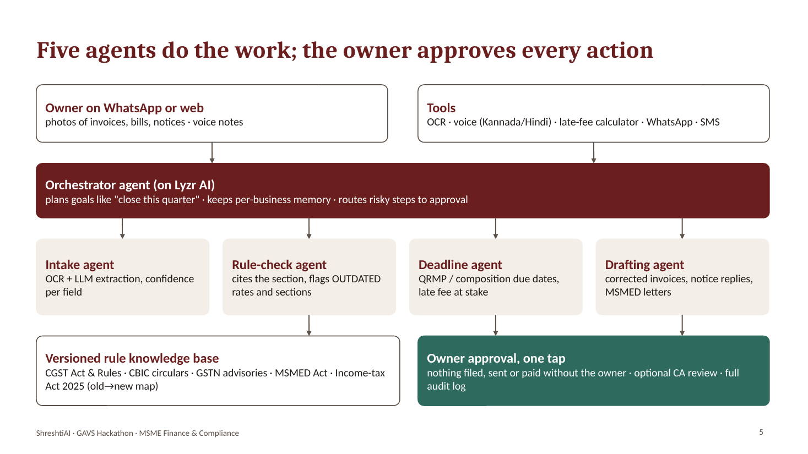

# ShreshtiAI — the digital munim for India's micro enterprises

**Check before you file. Get paid on time.**

ShreshtiAI is an agentic AI compliance assistant for micro enterprises. An owner sends photos of invoices, bills and government notices on WhatsApp or the web. A team of AI agents reads them, checks them against GST, income-tax and MSMED Act rules, flags every error and deadline **with the exact rule section cited**, and produces the corrected invoice, return summary, notice reply or payment reminder, which goes out only after the owner approves it with one tap.

> **GAVS Hackathon** · Theme: MSME Finance and Compliance · Problem 3.1: *Micro enterprises lose time and profit to compliance paperwork*
> **Status:** idea round. The retrieval engine is reused from my deployed project [BrandSentry AI](https://github.com/KPCHIRAGGUPTHA/BRAND_SENTRY_AI). The first deterministic GST rules are in this repo with tests. The full agent prototype is planned for the prototype round.



---

## The problem

| Fact | Figure |
| --- | --- |
| Udyam-registered MSMEs | 9.16 crore (31 Jul 2026), 99.3% micro |
| Compliance obligations, single-state manufacturing MSME | 1,450+ a year |
| Annual cost of those obligations | ₹13–17 lakh |
| GST late fee | ₹50/day per return (₹20 nil), plus 18% p.a. interest |
| Delayed-payment claims still pending for micro and small suppliers | ₹20,979 crore (Aug 2026) |

Recent rule changes removed the chance to fix mistakes later. From the July 2025 tax period GSTR-3B liability is locked to GSTR-1. Returns can't be filed more than 3 years late. And the Income-tax Act 2025 (in force from 1 April 2026) renumbered sections owners and tools still quote. Micro traders need a **checker before filing**, not just a filer after. Sources and detail: [`docs/PROBLEM_RESEARCH.md`](docs/PROBLEM_RESEARCH.md).

## How it works

1. **Snap:** the owner sends invoices, bills or a notice as a photo, PDF or voice note.
2. **Check:** agents extract the fields and check them against the rules, citing the section.
3. **Remind:** the deadline agent knows the business's scheme (monthly, QRMP or composition) and warns before due dates, with the fee at stake.
4. **Draft and approve:** the corrected invoice line, return summary, notice reply or MSMED payment reminder is drafted. Nothing is filed, sent or paid without the owner.

Every finding is **COMPLIANT**, **NON-COMPLIANT**, **OUTDATED** (a rate changed under GST 2.0, or a 1961-Act section replaced by the 2025 Act) or **NEEDS REVIEW**. The agent abstains rather than guesses.

## Built for Bharat

The brief asks for solutions that work for people with low literacy, limited connectivity and low-cost phones. ShreshtiAI is designed for that:

- **Voice-first:** owners speak and listen in Kannada or Hindi, with no forms to read.
- **Any low-cost phone:** it runs over WhatsApp on an entry-level Android phone, with no app install.
- **Patchy networks:** photos are compressed for 2G/3G, uploads are queued while offline, and reminders fall back to SMS where there's no data.
- **Assisted use:** a trader-association volunteer or the owner's CA can operate it on the owner's behalf.

## The agents

| Agent | Job |
| --- | --- |
| Orchestrator (on Lyzr AI, the hackathon's AI partner) | Plans goals like "close this quarter", keeps per-business memory, routes risky steps to approval |
| Intake | OCR + LLM extraction of GSTIN, HSN, rates, tax amounts, dates, with confidence per field |
| Rule-check | Deterministic checks first, then hybrid BM25 + vector retrieval over versioned official texts. Cite or abstain |
| Deadline | Due dates for monthly / QRMP / composition filers; late fee and interest at stake |
| Drafting | Corrected invoices, notice replies, MSMED 15/45-day reminders, in English, Kannada or Hindi |

Design detail: [`docs/ARCHITECTURE.md`](docs/ARCHITECTURE.md).

## What already works

**Deterministic GST rules (this repo), with no LLM involved:**

```bash
pip install pytest
python -m pytest -q        # 12 tests
```

- `shreshti/rules/gstin.py` validates GSTIN format, state code and mod-36 checksum
- `shreshti/rules/tax_type.py` checks CGST + SGST vs IGST against the supplier state and place of supply, with special cases sent to NEEDS REVIEW
- `shreshti/rules/late_fee.py` calculates the GSTR-1/3B late fee with turnover caps, nil-return cap and 18% interest

Numbers and checksums are computed in code, never by a model.

**Retrieval and verdict engine (BrandSentry AI, deployed):** hybrid BM25 + dense retrieval with reranking, a cite-or-abstain verdict engine that rejects unverified evidence, versioned policy registry, OCR, audit log and evaluation harness. The live engine demo is at [brandsentry-web.onrender.com](https://brandsentry-web.onrender.com). It's on Render's free tier, so the first load can take about a minute. What gets reused and what changes: [`docs/ENGINE_REUSE.md`](docs/ENGINE_REUSE.md).

## Proof plan (prototype round)

- **Head-to-head benchmark:** about 20 labelled synthetic invoices with known errors, ShreshtiAI's agents vs a single LLM prompt on the same model. It measures errors caught, false alarms and citation accuracy, and the dataset and method will be published here.
- **No-sign-up demo:** role-based logins (Shop owner, Chartered accountant, Trader association) on a fictional shop, *Sri Lakshmi Traders, Birur*.
- **Tamper-evident audit:** every approval is signed and hash-chained.

Detail: [`docs/DEMO_AND_BENCHMARK_PLAN.md`](docs/DEMO_AND_BENCHMARK_PLAN.md).

## Who benefits

- **Shop owner:** no avoidable fines, and paid on time.
- **Chartered accountant:** pre-checked files, so one CA can serve far more small clients.
- **Trader association:** members stay compliant and credit-ready.

## Roadmap

1. **Hackathon prototype:** invoice checker, deadline agent, notice explainer, MSMED reminder, in English and Kannada.
2. **Community pilot:** 50–100 traders through associations, a WhatsApp bot, Hindi/Telugu/Tamil, a CA review queue, and Vyapar/Tally export.
3. **Credit bridge (problem 3.2):** a consented compliance history matched to MUDRA, CGTMSE and PMEGP, and to GST Sahay / Account Aggregator lenders.

See [`docs/ROADMAP.md`](docs/ROADMAP.md).

## Submission files

- [`submission/ShreshtiAI_GAVS_Hackathon.pdf`](submission/ShreshtiAI_GAVS_Hackathon.pdf) is the pitch deck ([PowerPoint version](submission/ShreshtiAI_GAVS_Hackathon.pptx))
- [`submission/SUBMISSION_TEXT.md`](submission/SUBMISSION_TEXT.md) is the text submitted on HackCulture

## Why the name

A *shreshti* led the merchant guilds of the Arya Vysya trading tradition, and the *munim* kept a shop's accounts. ShreshtiAI rebuilds that trusted munim as an AI agent for every small trader.

## Limits

ShreshtiAI is a preparatory assistant. Legal responsibility for every filing stays with the authorised signatory, as with any filing tool. Rules change through notifications and circulars, so every answer carries a "rule as of" date and uncertain cases go to NEEDS REVIEW.

---

**K P Chirag Guptha** · M.Tech Integrated Software Engineering, VIT Vellore · [GitHub](https://github.com/KPCHIRAGGUPTHA) · [LinkedIn](https://www.linkedin.com/in/k-p-chirag-guptha)
