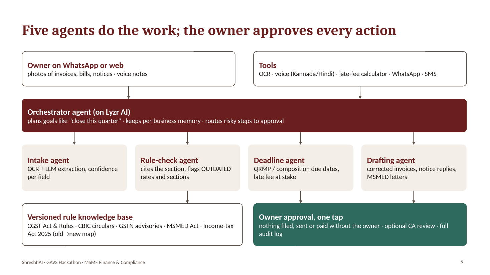

# Architecture

## Principles

1. **Code before model.** Anything that can be computed (GSTIN checksum, tax type, rates, late fees, dates) is computed in plain code. The LLM reads documents and writes explanations; it never does arithmetic or decides a rule exists.
2. **Cite or abstain.** Every finding quotes a section from a versioned official text. If no passage supports a verdict, the answer is NEEDS REVIEW.
3. **Owner approves.** Nothing is filed, sent or paid without a one-tap approval, and every step is logged.
4. **Rule as of.** Each knowledge-base document carries a version and an effective date. A finding based on a superseded rule is labelled OUTDATED.

## Agents

| Agent | Input | Output | Tools |
| --- | --- | --- | --- |
| Orchestrator | Owner goal or a schedule trigger | Plan of agent calls; approval requests | Per-business memory (GSTIN, scheme, filing history, buyers) |
| Intake | Photo, PDF, voice note | Invoice JSON with a confidence score per field | OCR (Tesseract / PyMuPDF), LLM extraction |
| Rule-check | Invoice JSON or notice text | Findings: COMPLIANT / NON-COMPLIANT / OUTDATED / NEEDS REVIEW + cited section | `shreshti/rules/*`, hybrid retriever, verdict engine |
| Deadline | Business profile | Upcoming due dates, fee at stake, reminders | Calendar, `late_fee.py` |
| Drafting | Findings, notice, overdue receivables | Corrected invoice line, notice reply, MSMED reminder | Templates with approved wording, PDF generator, WhatsApp |

## Flow for "check this invoice"

1. Intake extracts the fields. Any field below the confidence threshold is asked back to the owner.
2. Rule-check runs the deterministic checks: GSTIN, tax type, HSN rate, arithmetic.
3. For anything rules can't settle, it retrieves passages and the verdict engine decides, with citation validation.
4. Drafting proposes a corrected line using approved wording.
5. The orchestrator asks the owner to approve. The decision is appended to the hash-chained audit log.

## Low-literacy and low-connectivity design

- Voice notes in and out (speech-to-text and text-to-speech in Kannada and Hindi), so nothing has to be read or typed.
- WhatsApp as the main interface: no app install, works on entry-level Android phones.
- Images compressed on upload for 2G/3G; uploads queued and retried when the network drops.
- SMS fallback for due-date reminders when the phone has no data.
- An assisted mode, so a trader-association volunteer or the owner's CA can act for the owner, with the owner still approving.

## Knowledge base

CGST Act and Rules, CBIC notifications and circulars, GSTN advisories, MSMED Act 2006 (sections 15–16), Income-tax Act 2025 with a map from 1961-Act sections, and MSME ministry FAQs. Each source is stored with a version, an effective date and a source URL.

## Stack

Agent orchestration on Lyzr AI (the hackathon's AI partner, using participant credits), with a LangGraph fallback · FastAPI · ChromaDB + BM25 (rank-bm25) · sentence-transformers (all-MiniLM-L6-v2) · PyMuPDF + Tesseract · SQLite (registry, audit) · React + TypeScript + Vite · provider-independent LLM interface · Docker on Render · WhatsApp via Twilio sandbox for the demo.
